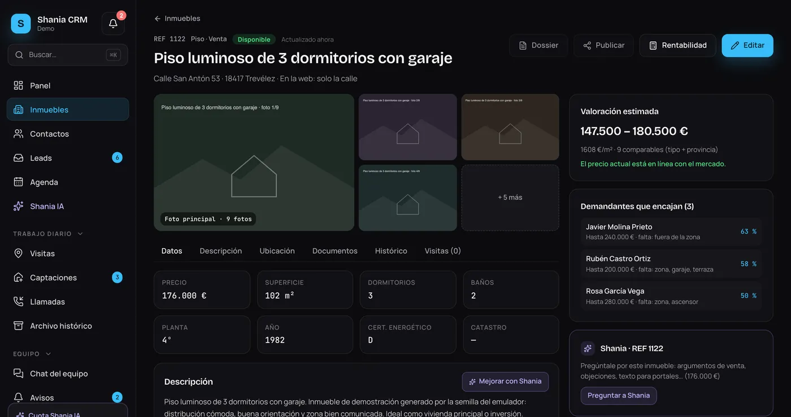

# Shania CRM

**El CRM inmobiliario que trabaja contigo, con su propia IA dentro.**
Inmuebles, contactos, portales y documentos en un solo sitio, con Shania, una asistente virtual con IA que redacta, ordena y avisa para que tú vendas. Hecho en Granada por Shania Webstudio.

*Ficha de inmueble en la versión web, en acceso anticipado. Datos de demostración.*

Este repositorio es solo de presentación. El código es privado y no está disponible aquí. Shania CRM se contrata por agencia: [escríbenos](#contratar).

## Qué tiene

### Gestión comercial
- Leads de idealista, Fotocasa, pisos.com, Milanuncios, Habitaclia y tu web, creados solos leyendo el correo de la agencia.
- Contactos con estado de consentimiento, origen, termómetro de interés y agente captador.
- Demandantes cruzados con la cartera: al dar de alta una vivienda, avisa de quién la estaba esperando.
- Agenda por agente, sincronizada con Google Calendar y con la app móvil.

### Publicación en portales
- API oficial de Fotocasa Pro (también Habitaclia) y pisos.com, con revisión previa de cada ficha.
- Feed Kyero para portales internacionales; idealista, en cuanto el portal active la pasarela.
- Título y descripción de cada ficha en cuatro idiomas.

### Fotos y material de venta
- Quitar objetos, vaciar la estancia, fachada, staging, cielo y luces, rediseño y ajustes en lote.
- No tocan estructura, ventanas ni medidas. Cada retoque queda registrado y la imagen retocada se etiqueta, como exige el artículo 50 del Reglamento europeo de IA.
- Dossier del inmueble en varios idiomas, vídeo vertical para redes, tour 360° y render de planos.

### Documentos y administración
- Arras, reserva, encargo de venta, alquiler y nota de encargo con exclusiva, con firma digital y seguimiento.
- Gastos de compraventa línea a línea, con informe en PDF con la marca de la agencia.
- Calculadora de inversión: rentabilidad, flujo mensual y TIR a diez años.
- Personal y registro de consentimientos.

## La IA que lleva dentro
Shania no es un chat aparte: trabaja dentro de las fichas, los contactos y los documentos, y siempre propones o revisas tú antes de publicar. Coordina a 8 especialistas:

| Especialista | Qué hace |
|---|---|
| Redactora | Descripciones de anuncio en varios idiomas y el SEO de cada ficha |
| Media IA | Nueve herramientas de fotografía |
| Valoración | Horquilla de precio con los comparables de tu propia cartera en ese municipio |
| Legal | Consultas con la ley citada del BOE, contratos tipo, comparador y análisis de documentos (módulo Shania Legal) |
| Fiscal | Modelos 303, 130 y 111, gastos e ingresos y facturación VERI\*FACTU (módulo Shania Conta) |
| Gestoría | ITP, plusvalía, notaría e IRPF, con informes para comprador y vendedor |
| Recepcionista | Shania Voz: atención por voz con transcripción y resumen en el CRM. **Próximamente: está en pruebas** |
| Edición de vídeo | Vídeos verticales del inmueble con guion, textos y música, desde las fotos de la ficha |

La IA va incluida en la cuota, con un cupo al mes según el plan.

## Facturación VERI\*FACTU
Módulo Shania Conta: registros encadenados con huella SHA-256, código QR en cada factura y registro de anulación. Ha superado el entorno de preproducción de la Agencia Tributaria en septiembre de 2026 con la aplicación de contabilidad. Para producción hace falta el certificado de representante de cada empresa.

## Contratar
- **Demo de 30 minutos:** https://shaniacrm.com/demo
- **Funciones y precios:** https://shaniacrm.com/ y https://shaniacrm.com/precios
- **Correo:** hola@shaniawebstudio.com
- **Teléfono y WhatsApp:** +34 675 15 87 85

Shania Webstudio · Chauchina (Granada)

© 2026 Shania Webstudio. Todos los derechos reservados. Este repositorio no concede ninguna licencia sobre Shania CRM ni sobre sus marcas.
